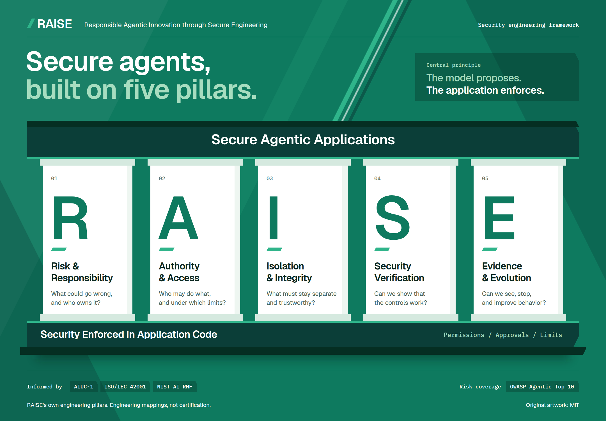

# The five pillars of RAISE

**RAISE: Responsible Agentic Innovation through Secure Engineering.**

RAISE organizes secure agent development into five engineering pillars. The central rule is simple: **the model proposes; the application enforces.** Permissions, approvals, isolation, and resource limits must remain effective when a model produces a harmful proposal.

Download the [PNG](raise-infographic.png) or edit the [SVG](raise-infographic.svg). The SVG names the Geist and IBM Plex Mono typefaces (SIL Open Font License 1.1) but does not embed them. Install both before editing or rendering it; otherwise it falls back to system fonts. The PNG was rendered with both.

## R: Risk & Responsibility

**What could go wrong, and who owns it?**

Define intended use, affected people, harmful outcomes, and an accountable owner. Map the agents, tools, data, providers, and dependencies involved. Set risk limits and decide which actions need human oversight.

Evidence: a scoped system inventory, threat assessment, and owned risk decisions.

## A: Authority & Access

**Who may do what, and under which limits?**

Use trusted application state to check the caller, tenant, task, and target resource. Give tools and delegated agents only the authority they need. Bind required approvals to the exact action, and recheck current permissions when queued work or retries execute. Propagate revocation.

Evidence: authorization rules, approval records, and tests of access, delegation, and revocation.

## I: Isolation & Integrity

**What must stay separate and trustworthy?**

Keep untrusted documents, messages, tool results, and memory from becoming security policy. Isolate tenant data, credentials, and generated code. Check the provenance and permissions of dependencies, skills, and MCP servers. Apply data policy to model providers and outbound destinations as well as tools.

Evidence: enforced trust boundaries, sandbox and network configuration, dependency review, and data handling rules.

## S: Security Verification

**Can we show that the controls work?**

Exercise actual authorization and execution paths with injection, tool misuse, bypass, replay, revocation, and failure cases. Pair blocked-action tests with authorized success cases. Observe downstream effects, label simulated evidence accurately, and define release criteria for the affected controls.

Evidence: reproducible tests, observed outcomes, implementation references, and explicit verification gaps.

## E: Evidence & Evolution

**Can we see, stop, and improve behavior?**

Distinguish proposed actions, attempted actions, denied actions, and confirmed effects while minimizing sensitive data. Monitor operations and enforce shared resource budgets outside the model. Provide cancellation, revocation, and recovery. Review incidents and changes to models, tools, policies, or runtime behavior, then update controls and tests.

Evidence: protected audit records, monitoring and response procedures, recovery checks, and updated risk decisions.

## How the pillars work together

For a support agent that can issue refunds:

1. **R** defines permitted refund behavior, potential harm, an owner, and an approval threshold.
2. **A** checks the authenticated operator, tenant, order, refund amount, and any required approval immediately before execution.
3. **I** prevents a malicious support ticket from granting authority and keeps payment credentials inside a narrow adapter.
4. **S** tests injected tickets, cross-tenant access, altered approvals, duplicate refunds, and authorized refunds through the real execution path.
5. **E** records attempts and confirmed effects, caps cumulative spending, stops a failing run, and feeds incident findings into the next change.

The pillars apply throughout development and operation. They are not five one-time approvals. A control can support several pillars, and the [OWASP coverage matrix](../references/owasp-agentic-top-10.md) remains the detailed checklist for all ten agentic risk categories.

## Framework basis

These pillar names are RAISE's own organization of its engineering guidance. AIUC-1 informs selected controls and evidence; ISO/IEC 42001 informs responsibilities and continual improvement; NIST AI RMF informs risk management. OWASP's Agentic Top 10 supplies the risk categories used to check coverage. The [source snapshot and mapping](../references/frameworks.md) records the editions, primary sources, and limits of those mappings.

Using RAISE does not establish certification or guarantee complete protection. The infographic and this explanation are original project material under the [MIT license](../LICENSE).
