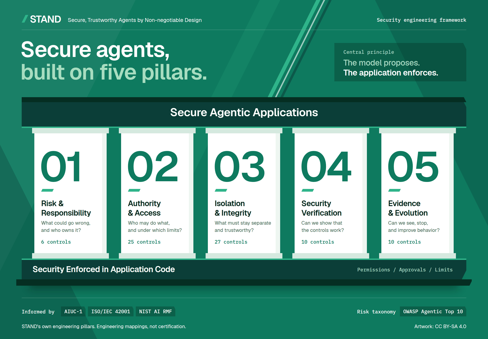

# The five pillars

This framework organizes secure agent development into five engineering pillars. Every control implements one principle:

**The model proposes. The application enforces.**

"The application" means the deterministic controls the model cannot alter: application code, identity and policy services, sandboxes, network policy and infrastructure. Permissions, approvals, isolation, and resource limits must remain effective when a model follows an injected instruction or produces a harmful proposal.

Download the [PNG](stand-infographic.png) or edit the [SVG](stand-infographic.svg). The SVG names the Geist and IBM Plex Mono typefaces (SIL Open Font License 1.1) but does not embed them. Install both before editing or rendering it; otherwise it falls back to system fonts. The PNG was rendered with both. The artwork's foundation label, "Security Enforced in Application Code", uses "application" in the sense defined above.

Each pillar below gives the question it answers, its purpose, its controls in catalog v0.1.0 and the artifacts it produces. Controls are Level 1 unless marked. The control statements, applicability conditions and verification cases are normative and live in the generated files under [references/controls/](../references/controls/index.md); this guide only summarizes them.

## R: Risk & Responsibility

**What could go wrong, and who owns it?**

Define intended use, affected people, forbidden outcomes, and one accountable human owner. A coding agent never records an owner, a risk acceptance or an exception that a human did not give; it writes "unassigned" instead. Profile every agent context: does it read untrusted input, can it reach sensitive data, can it cause an external effect, and how much autonomy does it have? The answers compute the required level, and a property that is unknown counts as present. Give every tool, trigger and delegate a recorded task need, and use a fixed workflow or a lower autonomy scope wherever that meets the need (Least Agency, from the OWASP Top 10 for Agentic Applications 2026). Map the agents, tools, data, providers, and dependencies involved, trace requests across their boundaries, and record which ASI risks apply. Register every consequential operation with the trusted source of each argument that decides where data or value goes, its limits and its approval policy.

Controls ([references/controls/R.md](../references/controls/R.md)):

- Scope and ownership: R-01 Accountable scope, owner and risk acceptance.
- Capability and autonomy: R-02 Capability profile and required level; R-03 Least Agency.
- Threats, operations and data: R-04 Threat model: inventory, boundary trace and ASI applicability; R-05 Consequential operations register and trusted sources; R-06 Data classification and disclosure policy.

Artifacts: the record's scope and owner section, the capability profile of each context with its computed and selected level, the inventory and threat model with ASI applicability, the consequential operations register, and the data classification policy.

## A: Authority & Access

**Who may do what, and under which limits?**

Use trusted application state to check the caller, tenant, task, and target resource. Send every proposal through one dispatch path that denies by default and evaluates authority immediately before each effect, including for queued, retried and delegated work. Give tools and delegated agents only the authority they need. Once untrusted content has entered a context, recipients, URLs, payees, amounts and other consequential values come from a trusted source or receive fresh confirmation, a value the model invented is denied, and the run stays inside the task the principal asked for, even for actions the principal could take. A new contact address, recovery channel, payout account, webhook or forwarding rule takes effect only after verification outside the conversation, and the previous destination is notified. Outbound messages, comments and documents carry only data their recipients and readers may receive. A context that holds untrusted input, sensitive data and external effects together is gated under the Rule of Two. Bind required approvals to the exact action, and recheck current permissions when queued work or retries execute. Render approval previews from canonical server data; model explanations cannot alter what is approved. Give each agent and delegated worker its own workload identity, distinct from the user it serves, with an identified owner, and act for users only through constrained, expiring delegation, never by reusing their session or a broad service credential. Propagate revocation. Enforce cumulative limits on time, iterations, tool calls, cost, spend and descendant agents in trusted shared accounting; a child cannot reset its parent's budget.

Controls ([references/controls/A.md](../references/controls/A.md)):

- Dispatch and authorization: A-01 Single dispatch path; A-02 Deny by default, strict schemas and canonical requests; A-03 Authority from trusted context; A-04 Authorization evaluated at the moment of effect; A-09 Least-privilege tool profiles and auto-run limits.
- Consequential values and task scope: A-06 Provenance-aware consequential values; A-07 Task-scope binding; A-08 Rule of Two gating; A-10 Destructive and irreversible operation guard; A-24 Outbound payload checks; A-25 Verified changes to redirecting values.
- Approvals: A-11 Approval binding; A-12 Approval presentation integrity; A-13 Approval anomaly cues and fatigue management (Level 2); A-14 Step-up and dual control for highest-impact effects (Level 3).
- Delegation, identity and self-modification: A-15 Delegation by intersection and receiver re-authorization; A-16 Token handling and MCP authorization; A-17 Agent workload identity and token exchange (Level 2); A-18 Sender-constrained tokens (Level 3); A-19 Principals, triggers and shared contexts; A-23 No self-modification or self-replication.
- Effects and limits: A-05 Durable idempotency and atomic effects; A-20 Cumulative run budgets; A-21 Bounded retries and caller-enforced deadlines; A-22 Principal, tenant and provider quotas (Level 2).

Artifacts: dispatcher and policy code references, the tool registry and tool profiles, approval records and preview components, identity and delegation configuration, budget and quota settings, and tests of access, provenance, delegation and revocation.

## I: Isolation & Integrity

**What must stay separate and trustworthy?**

Keep untrusted documents, messages, tool results, and memory from becoming security policy. Untrusted content enters the model only as data and taints every proposal, summary, memory write and delegated message that follows; a separation pattern earns credit only when it is verified. System prompts hold no secrets and no enforcement logic. Isolate tenant data, credentials, and generated code: authorize retrieval before content reaches the model, give memory provenance and expiry, read consequential facts from their system of record at execution time, and keep conversation state on the server. Treat model output as untrusted at every destination: escape, validate and sanitize before rendering or downstream interpretation, and close rendering and network channels that could carry data out. Contain code execution, browsers and local tools so that nothing model-influenced can reach ambient credentials or enforcement components. Check the provenance and permissions of dependencies, skills, and MCP servers. Apply data policy to model providers and outbound destinations as well as tools.

Controls ([references/controls/I.md](../references/controls/I.md)):

- Untrusted content and separation: I-01 Untrusted content stays data and taints its context; I-02 Enforced separation patterns; I-03 Hidden-text normalization and reviewer view (Level 2); I-04 System prompts hold no secrets or enforcement.
- Credentials, data and state: I-05 No ambient credentials or enforcement access in model-influenced processes; I-06 Retrieval authorization before context; I-07 Memory provenance, scope, expiry and revocation; I-08 System of record for consequential facts; I-09 Server-held conversation state.
- Model providers: I-10 Provider data routing; I-11 Provider-executed tools.
- Egress and output: I-12 Network egress boundary; I-13 Rendered-output exfiltration channels; I-14 Sink-safe output handling and no implicit execution; I-26 Agent-to-human communication integrity (Level 2).
- Execution containment: I-15 Code-execution sandbox baseline; I-16 Strong isolation tier (Level 2); I-17 Browser and computer-use containment; I-27 Per-tenant kernel isolation for code execution.
- Tools, MCP and other agents: I-18 Pinned descriptors and fully qualified tool identity; I-19 Local tool and third-party component confinement; I-20 MCP sampling and elicitation; I-21 Inter-agent message integrity; I-22 Fault propagation containment (Level 2).
- Coding agents and components: I-23 Coding and CI agent boundaries; I-24 Component pinning and intake; I-25 Model artifact integrity.

Artifacts: enforced trust boundaries, sandbox, browser and network configuration, rendering and egress allowlists, provider routing rules, the pinned component and descriptor inventory, and data handling rules.

## S: Security Verification

**Can we show that the controls work?**

Exercise actual authorization and execution paths with injection, tool misuse, bypass, replay, revocation, and failure cases. Inject crafted proposals directly, so tests do not depend on how the current model behaves. Pair blocked-action tests with authorized success cases. Cover every untrusted channel in the profile with at least one injected request that the principal could legitimately make but did not ask for. Observe downstream effects, label simulated evidence accurately, and define release criteria for the affected controls. Each control names a minimum evidence scope, from inspection to deployed, and a mock proves only the boundary it exercises. This pillar defines the release criteria: the severity-rated gate blocks any readiness claim while an applicable critical-boundary control is failing or unverified, and security regressions run as required checks. Higher levels add live-model evaluation, independent adversarial review and replay before rollout.

Controls ([references/controls/S.md](../references/controls/S.md)):

- Test design: S-01 Enforcement-path tests; S-02 Hostile proposals with authorized twins; S-04 Injection channel coverage with within-authority payloads; S-05 Failure, revocation and concurrency test matrix.
- Evidence and release: S-03 Evidence scope, runtime boundaries and record integrity; S-06 Severity-rated release gate; S-07 Security regressions as required checks.
- Assurance depth: S-08 Live-model adversarial evaluation (Level 2); S-09 Independent adversarial review with adaptive attacks (Level 3); S-10 Replay before rollout and before authority expansion (Level 3).

Artifacts: hostile tests with authorized twins keyed as `<ID>/T<n>`, observed outcomes with the evidence scope achieved, the release gate decision with severities, and explicit verification gaps.

## E: Evidence & Evolution

**Can we see, stop, and improve behavior?**

Distinguish proposed actions, attempted actions, denied actions, and confirmed effects while minimizing sensitive data. Keep audit records out of the agent's reach, and write them before the effect they describe. Route baseline security signals, such as denials from tainted contexts, budget stops, component drift and user reports, to a named owner. Detection supplements enforcement and never replaces it; for persistent or within-authority attacks (ASI06, ASI08, ASI10), tests confirm that the signal is emitted and reaches its owner. Operate stop, cancellation and recovery mechanisms, and monitor budget consumption: an operator can stop a run and all its descendants without a deploy, and at higher levels the kill switch works at tenant and global scope with a measured revocation latency. The budgets themselves are enforced under Authority & Access. Review incidents and changes to models, tools, policies, or runtime behavior, then update controls and tests.

Controls ([references/controls/E.md](../references/controls/E.md)):

- Audit: E-01 Decision and effect audit trail; E-02 Audit custody and audit-before-effect; E-03 Forensic context manifest (Level 2); E-10 Tamper-evident audit (Level 3).
- Detection: E-04 Baseline security signals routed to an owner; E-05 Behavioral detection and automatic containment (Level 2).
- Stop and recovery: E-06 Stop without deploy; E-07 Kill-switch scopes and measured revocation latency (Level 2); E-08 Quarantine, recovery and exercised incident response (Level 2).
- Change: E-09 Governed change and re-assessment.

Artifacts: protected audit records, signal routing with owners and response targets, stop and recovery procedures with their test results, and change records with updated risk decisions.

## Levels

Every control has exactly one level, and a higher level only adds controls. The capability profile computes the required level for each agent context: Level 3 when a context holds untrusted input, sensitive data and external effects together, or runs with full autonomy and external effects; Level 2 when it holds two of the three properties, or runs with supervised autonomy or more; Level 1 otherwise. A system's level is the highest over its contexts, and an owner may declare a higher level but never a lower one. Many Level 1 controls apply only when their condition holds; a public documentation assistant without tools carries far fewer controls than a support agent that issues refunds. See [references/profile-and-levels.md](../references/profile-and-levels.md) for the selection rule and [references/conformance.md](../references/conformance.md) for statuses, the release gate and the critical-boundary set.

## How the pillars work together

The pillars apply throughout development and operation. They are not five one-time approvals. A control can support several pillars, and in the control catalog each control has one primary pillar. The trace runs from pillar to control ID, from the control to the ASI risks it lists and its mappings in [references/mappings.md](../references/mappings.md), then to hostile tests keyed by `<ID>/T<n>`, and finally to a row in the security record keyed by the same ID.

Number of controls in each pillar that list each ASI risk (catalog v0.1.0):

| Pillar | Controls (L1/L2/L3) | ASI01 | ASI02 | ASI03 | ASI04 | ASI05 | ASI06 | ASI07 | ASI08 | ASI09 | ASI10 |
| --- | --- | --- | --- | --- | --- | --- | --- | --- | --- | --- | --- |
| R | 6 (6/0/0) | 5 | 6 | 5 | 2 | 2 | 5 | 2 | 3 | 3 | 4 |
| A | 25 (20/3/2) | 10 | 12 | 16 | 0 | 2 | 2 | 4 | 8 | 7 | 9 |
| I | 27 (23/4/0) | 11 | 8 | 11 | 7 | 9 | 8 | 5 | 4 | 7 | 1 |
| S | 10 (7/1/2) | 6 | 7 | 5 | 4 | 3 | 4 | 2 | 5 | 6 | 6 |
| E | 10 (5/4/1) | 4 | 3 | 2 | 5 | 0 | 3 | 0 | 9 | 3 | 10 |

The counts include four cross-cutting governance and verification controls that list every category (R-01, R-04, S-01 and S-06). They govern or verify the controls that address each risk rather than mitigating its mechanism, and the generated index lists them once, on a separate cross-cutting line.

The [ASI view](../references/owasp-agentic-top-10.md) lists, for each risk in the OWASP Top 10 for Agentic Applications 2026, the controls designed to address it. It is a starting point for the application's threat model, not a promise of complete coverage.

### Worked example: a support agent that issues refunds

Support staff use an agent to resolve customer tickets in a multi-tenant help desk. The agent reads ticket threads, looks up orders and payments, issues refunds and replies to customers. The authenticated principal is the staff member, called the operator here. The customer is the account holder recorded in the ticketing system, not whoever the ticket text claims to be. The model never chooses where money goes.

1. **R** profiles the context: tickets are untrusted input, order and payment data are sensitive, and refunds are an external effect, so all three properties are present and the context computes Level 3 (R-02). The agent gets only the tools the task needs (R-03), and the register lists the refund as a financial operation whose destination is the order's original payment instrument and whose amount is capped by the remaining refundable balance, both from the payments system of record, with an approval threshold and per-operator and per-customer limits (R-05). An accountable owner, never the coding agent, accepts any residual risk (R-01).
2. **A** takes the operator, tenant and order ownership from authenticated server state, limits the run to orders of the ticket's verified customer, and rechecks everything immediately before the refund (A-03, A-04, A-07). The dispatcher denies any destination other than the original payment instrument and any amount above the refundable balance, so injected text cannot redirect a refund the operator is otherwise allowed to issue (A-06). Because the context holds all three properties, the operator confirms each refund the agent proposes, or one plan that lists them with fully bound values (A-08 option (a)). Replies to customers pass a payload check, so a ticket cannot make the agent mail another customer's order data to the right address (A-24). An idempotency key in a durable ledger and cumulative limits stop duplicate and split refunds, and the run budget caps calls and cost (A-05, A-20). Above the threshold, the approval binds the exact order, amount and destination, is consumed atomically with the refund's durable intent record, and is shown on a server-rendered preview that marks where each value came from (A-11, A-12).
3. **I** keeps ticket text in a data position and marks the run tainted, so every refund proposal it influences is checked under A-06 (I-01). Balances and payment instruments are read from the system of record at execution time, payment credentials stay inside a narrow adapter that model-influenced processes cannot reach, and the staff console renders agent output without loading remote images and with inert links to hosts outside an allowlist, so a ticket cannot plant a link or image that carries data out (I-08, I-05, I-13).
4. **S** drives scripted hostile proposals through the real dispatcher, each paired with an authorized refund that succeeds exactly once (S-01, S-02): a ticket asking for a refund to a new card, a ticket naming another customer's order that the operator could legitimately refund (S-04), a refund split into amounts just under the threshold, an amount changed after approval, and one refund delivered to two workers at once. The release gate blocks a readiness claim while any of these boundaries fails or is unverified (S-06).
5. **E** records proposed, attempted, denied and confirmed refunds separately (E-01), routes provenance denials, budget stops and repeated near-threshold refunds to the owner (E-04), and lets an operator stop the run and cancel its queued refunds without a deploy (E-06). Incident findings become regression tests for the next change (S-07, E-09). Because the context is at Level 3, the Level 2 and Level 3 controls apply too, for example behavioral detection that suspends the agent on high-risk patterns such as a sensitive lookup followed by a reply to a new address (E-05).

Risks exercised: ASI01 Agent Goal Hijack (the injected ticket), ASI02 Tool Misuse & Exploitation (a permitted refund tool aimed at the wrong order or instrument), ASI03 Identity & Privilege Abuse (operator, customer and tenant identity), ASI08 Cascading Failures (retries and repeated refunds that budgets and stop controls contain) and ASI09 Human-Agent Trust Exploitation (the approval preview).

## Framework basis

These pillar names are this framework's own organization of its engineering guidance. The OWASP Top 10 for Agentic Applications 2026 (ASI01 to ASI10) is the risk taxonomy: each control lists the ASI risks it is designed to address. AIUC-1 informs selected controls and evidence. NIST AI RMF 1.0 (NIST AI 100-1), with its Generative AI Profile (NIST AI 600-1) as supporting guidance, informs risk management, measurement and monitoring: most anchors of R controls fall in GOVERN and MAP, of S controls in MEASURE, and of E controls in MEASURE and MANAGE. ISO/IEC 42001 informs responsibilities and continual improvement, as themes only. It concerns an organization's AI management system, so a security record becomes management-system evidence only if the organization adopts it within that system's scope and processes. The [source snapshot and mapping](../references/frameworks.md) records the editions, primary sources, and limits of those mappings, and [references/mappings.md](../references/mappings.md) gives the control-level mappings.

Using this framework does not establish certification or guarantee complete protection. This guide and the infographic are licensed under [CC BY-SA 4.0](../LICENSES/CC-BY-SA-4.0.txt).
